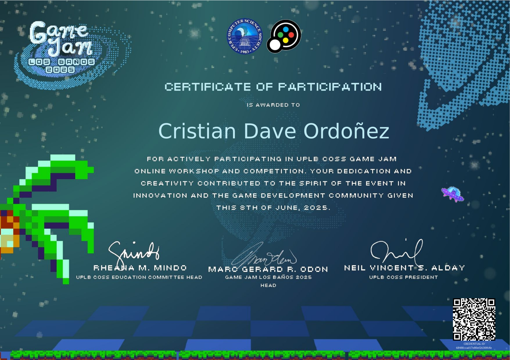
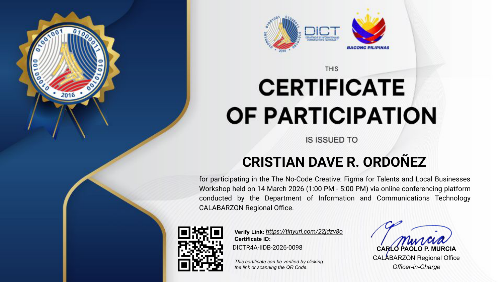

  

  

  

---

### 💫 About Me
I'm a 20-year-old BS Computer Science student, software engineer, and hardware enthusiast passionate about building secure AI pipelines, embedded networking tools, and interactive simulations. 

I enjoy collaborating on distributed systems and exploring the boundary between software engineering, automation, and physical systems.

#### 🚀 Featured Projects
*   **AI-Powered Mobile Fitness & Nutrition Platform (Mobile/AI):** Lead Backend & AI Developer for a cross-platform mobile health application built with **React Native (Expo)**, **TypeScript**, and **Supabase (PostgreSQL)**. Implemented optimistic UI caching via **TanStack React Query** and managed state with **Zustand**. Integrated an advanced LLM pipeline (via Hugging Face API) featuring automated key rotation, prompt injection guardrails, client-side rate limiting, and an isolated dual-tiered PostgreSQL database structure (Verified local bundle + remote USDA raw catalog) to prevent data hallucinations. Securely managed user identity validation with device UUIDs and Supabase Row Level Security (RLS).
*   **GuardAgent Sandbox (AI Security):** Developed a secure multi-agent pipeline simulation using **FastAPI** (Python), **Gemini 2.5 Flash**, and Hugging Face's **Deberta v3** prompt injection classifier. The system shields LLMs from prompt injections and handles PII redaction/de-redaction dynamically via token mapping.
*   **[Kayle Snatch](https://lyevan.itch.io/kalye-snatch) (Game Development):** Contributed to an interactive Godot game project in **GDScript**, implementing custom shaders (full-screen police strobe wanted level alert), designing wobbly animated QTE HUD systems, and styling the user interface with textured themes and layout optimizations.
*   **Vortex-U (Hardware/IoT):** Built a high-velocity ESP32-U Wi-Fi research tool in **C++** using a dual-core architecture to achieve hardware-verified 9,238 PPS injection through clock domain switching and netstack bypass.

#### 🛠️ What I Do
*   **AI Pipelines & Assistants:** Developing secure LLM architectures, prompt filters, conversational coaching cards, and autonomous project management agents (using FastAPI and Qwen) integrated with Telegram and n8n webhooks.
*   **Mobile App Development:** Building cross-platform mobile solutions using React Native, Expo Router, NativeWind (Tailwind CSS), offline sandboxing with Zustand, and React Query v5 optimistic caching.
*   **Simulations & Modeling:** Designing physics-based "Digital Twins" (using Unity PhysX) and machine learning models (Random Forest) for deterministic analysis of stochastic systems.
*   **Full-Stack & Dashboards:** Building responsive dashboards, learning platforms (such as Japanese study applications), and secure authentication pipelines.
*   **Workflow Automation:** Scripting custom local automation tools, web scraping systems, and downstream Trello/n8n integration endpoints.

---

### 💻 Tech Stack

<b>📱 Mobile Development</b>

 

  

<b>⚙️ Languages & Web Core</b>

 

  
  
  
  
  
  
  

<b>🎨 Frontend Frameworks & UI Design</b>

 

  
  
  
  
  
  

<b>🛡️ Backend & APIs</b>

 

  
  
  
  
  
  
  

<b>📊 Data Science & Machine Learning</b>

 

  
  
  
  
  
  

<b>🌐 Databases, DevOps & Cloud</b>

 

  
  
  
  
  
  
  
  
  

<b>🕹️ Game Development, Hardware & IoT</b>

 

  
  
  
  

<b>🛠️ Tools & Automation</b>

 

  
  
  
  
  
  

---

### 🏅 Certifications & Badges
<table align="center" border="0">
  <tr>
    <td align="center" style="padding: 10px;">
      <a href="https://www.credly.com/badges/fe66954b-ea17-4003-9f12-ff2098cfb84f" target="_blank">
         
        <b>Microsoft AI Skills Fest 2026</b>
      </a>
    </td>
    <td align="center" style="padding: 10px;">
      <a href="https://www.credly.com/badges/afd3cede-6934-473a-a2ed-1bef0f2a6deb" target="_blank">
         
        <b>Cisco Intro to Data Science</b>
      </a>
    </td>
  </tr>
  <tr>
    <td align="center" style="padding: 10px;">
      <a href="https://www.credly.com/badges/a15f6a41-2c1c-4441-96e2-2384bc9b026b" target="_blank">
         
        <b>Cisco OS Basics</b>
      </a>
    </td>
    <td align="center" style="padding: 10px;">
      <a href="https://www.credly.com/badges/bebc5c3c-607d-4c09-9aa0-bdb89d573a3e" target="_blank">
         
        <b>Cisco JS Essentials 1</b>
      </a>
    </td>
  </tr>
  <tr>
    <td align="center" style="padding: 10px;">
      <a href="https://actions.filpass.ph/?q=%7B%22type%22%3A%22DOCUMENT%22%2C%22payload%22%3A%7B%22uri%22%3A%22https%3A%2F%2Fciap-production-uploadbucket-1.s3.ap-southeast-1.amazonaws.com%2Fproduction%2F6847f1e11f2783cf8d164688%2FopenAttestationSharedCredential%2F1783446086306.opencert%22%2C%22documentId%22%3A%226848fccad17e80ef2630f64e%22%2C%22permittedActions%22%3A%5B%22VIEW%22%2C%22STORE%22%5D%2C%22redirect%22%3A%22https%3A%2F%2Fverified.filpass.ph%2F%22%7D%7D" target="_blank">
         
        <b>UPLB COSS Game Jam 2025</b>
      </a>
    </td>
    <td align="center" style="padding: 10px;">
      <a href="https://drive.google.com/file/d/1NElG7Pn_M85xUMy0kOfJg6GAEEXcwwoy/view?usp=sharing" target="_blank">
         
        <b>DICT: Figma for Talents (2026)</b>
      </a>
    </td>
  </tr>
  <tr>
    <td align="center" colspan="2" style="padding: 10px;">
      <a href="https://lyevan.itch.io/kalye-snatch" target="_blank">
         
        <b>UPLB COSS Game Jam 2026</b>
      </a>
    </td>
  </tr>
</table>

---

### 📊 GitHub Stats & Streaks

<table border="0" align="center" width="100%">
  <tr>
    <td align="center" width="50%">
      
    </td>
    <td align="center" width="50%">
      
    </td>
  </tr>
  <tr>
    <td align="center" colspan="2" style="padding-top: 15px;">
      
    </td>
  </tr>
</table>

---

### 📈 Activity Graph

  

---

### ✍️ Random Dev Quote

  

---

### 🤝 Connect & Support

<table border="0" align="center" width="100%">
  <tr>
    <td align="center" width="25%">
      
    </td>
    <td align="center" width="25%">
      
    </td>
    <td align="center" width="25%">
      
    </td>
    <td align="center" width="25%">
      
    </td>
  </tr>
</table>

  :>

